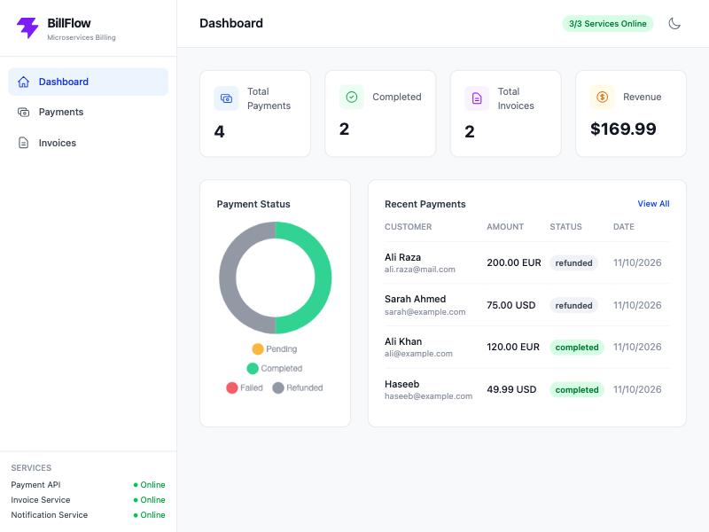
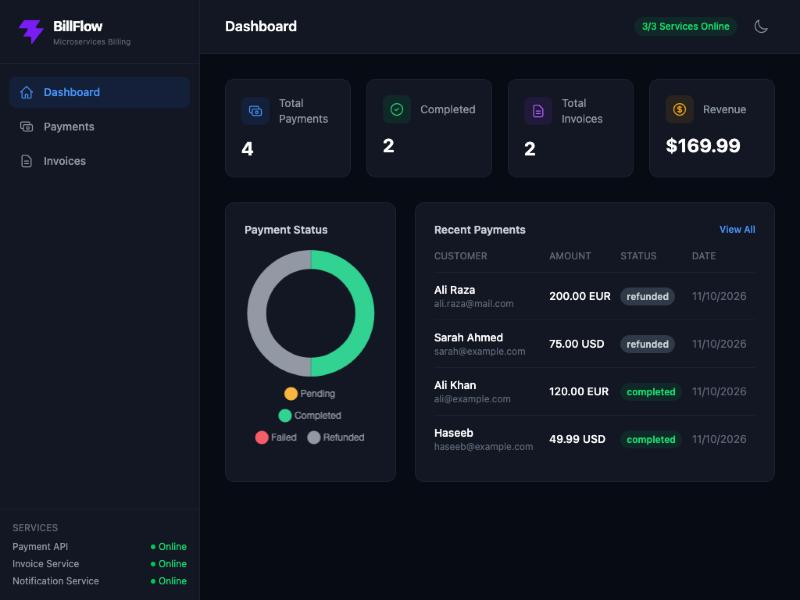
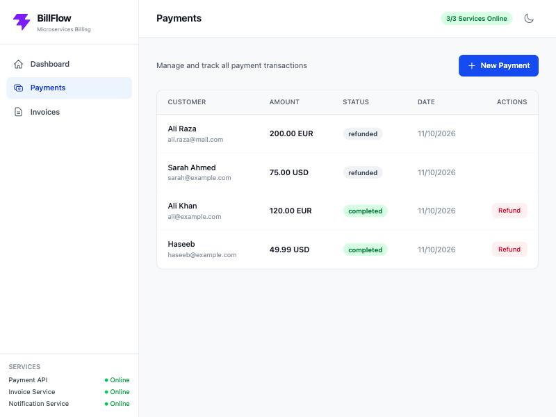
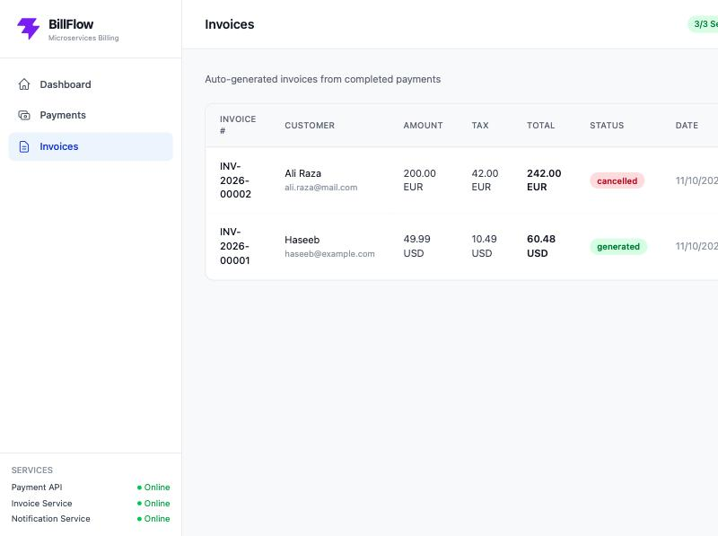
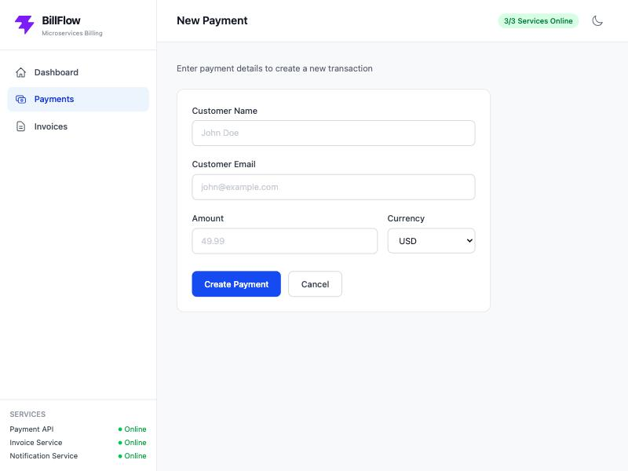
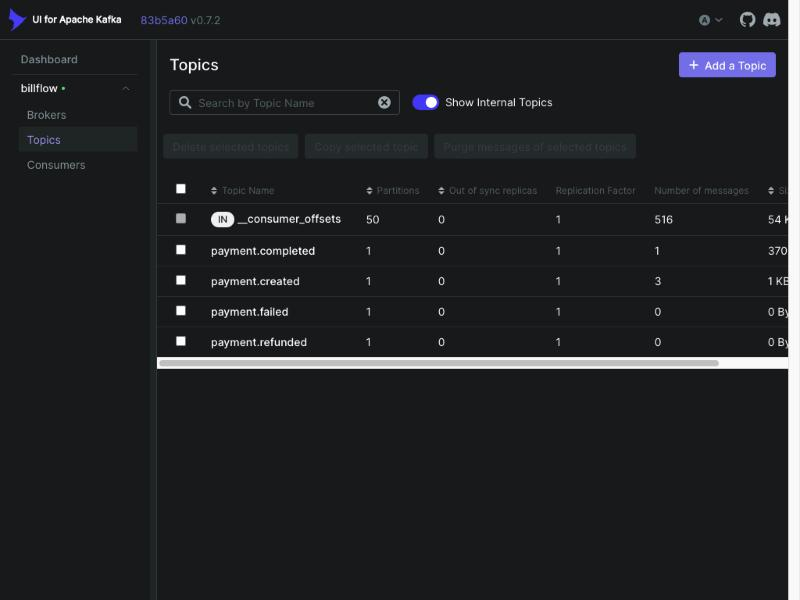

# BillFlow — Microservices Billing System

A production-style billing system built with microservices architecture. Three backend services communicate through Apache Kafka, with a Vue 3 dashboard for the frontend.

Built to demonstrate: microservices patterns, event-driven architecture, service layer design, and database-per-service isolation.

## Screenshots

| Dashboard (Light) | Dashboard (Dark) |
|-------------------|------------------|
|  |  |

| Payments | Invoices |
|----------|----------|
|  |  |

| Create Payment | Kafka UI — Event Topics |
|----------------|-------------------------|
|  |  |

## Architecture

```
                         ┌──────────────┐
                         │  Vue 3       │
                         │  Dashboard   │
                         │  :5173       │
                         └──────┬───────┘
                                │ REST API calls
                ┌───────────────┼───────────────┐
                │               │               │
        ┌───────▼──────┐ ┌─────▼──────┐ ┌──────▼───────┐
        │ Payment API  │ │  Invoice   │ │ Notification │
        │ Laravel/PHP  │ │  Service   │ │   Service    │
        │ :8001        │ │ FastAPI    │ │  Node.js     │
        └───────┬──────┘ │ :8002      │ │  :8003       │
                │        └─────▲──────┘ └──────▲───────┘
                │              │               │
                │        ┌─────┴───────────────┘
                │        │  Kafka consumers
                ▼        │
        ┌────────────────┴───┐
        │   Apache Kafka     │
        │   Event Bus        │
        └────────────────────┘
```

## Services

| Service | Tech | Port | Database | Role |
|---------|------|------|----------|------|
| Payment API | Laravel (PHP 8.3) | 8001 | MariaDB | Accepts payments, publishes events to Kafka |
| Invoice Service | FastAPI (Python 3.9) | 8002 | PostgreSQL | Auto-generates invoices on payment completion |
| Notification Service | Node.js + Express | 8003 | None | Sends email notifications on payment events |
| Dashboard | Vue 3 + Vite + Tailwind | 5173 | None | Frontend with dark/light mode, charts, and service health |

## Event Flow

1. User creates a payment via API or dashboard
2. Payment API saves to MariaDB and publishes `payment.created` to Kafka
3. A webhook simulates payment processing, status changes to completed
4. Payment API publishes `payment.completed` to Kafka
5. **Invoice Service** receives the event and auto-generates an invoice with tax calculation
6. **Notification Service** receives the event and sends a confirmation email

## Prerequisites

- [Docker Desktop](https://www.docker.com/products/docker-desktop/) (includes Docker Compose)

## Quick Start

```bash
# Clone the repo
git clone <repo-url>
cd BillFlow---Microservices-Billing-System

# Start everything
docker compose up --build

# Run database migrations (first time only, in a new terminal)
docker compose exec payment-api php artisan migrate --force
```

Wait for all containers to be healthy, then open:

- **Dashboard**: http://localhost:5173
- **Kafka UI**: http://localhost:8080

## API Endpoints

### Payment API (:8001)

| Method | Endpoint | Description |
|--------|----------|-------------|
| GET | `/api/health` | Health check |
| GET | `/api/payments` | List all payments |
| POST | `/api/payments` | Create a payment |
| GET | `/api/payments/{uuid}` | Get single payment |
| POST | `/api/payments/{uuid}/refund` | Refund a payment |
| POST | `/api/webhooks/stripe` | Simulate payment status change |

### Invoice Service (:8002)

| Method | Endpoint | Description |
|--------|----------|-------------|
| GET | `/api/health` | Health check |
| GET | `/api/invoices` | List all invoices |
| GET | `/api/invoices/{id}` | Get single invoice |
| GET | `/api/invoices/{id}/pdf` | Download invoice PDF |

### Notification Service (:8003)

| Method | Endpoint | Description |
|--------|----------|-------------|
| GET | `/api/health` | Health check |

## Testing the Full Flow

```bash
# 1. Create a payment
curl -s -X POST http://localhost:8001/api/payments \
  -H "Content-Type: application/json" \
  -d '{"customer_name": "John Doe", "customer_email": "john@example.com", "amount": 4999, "currency": "USD"}'

# 2. Complete the payment (replace UUID from step 1)
curl -s -X POST http://localhost:8001/api/webhooks/stripe \
  -H "Content-Type: application/json" \
  -d '{"payment_uuid": "PASTE-UUID-HERE", "status": "completed"}'

# 3. Check auto-generated invoice
curl -s http://localhost:8002/api/invoices | python3 -m json.tool

# 4. Check service logs to see the event chain
docker compose logs --tail=10 payment-api invoice-service notification-service
```

## Key Patterns

- **Service Layer**: Controller → Service → Model. Business logic lives in the service, not the controller.
- **Event-Driven Communication**: Services don't call each other directly. They publish events to Kafka and consume them independently.
- **Database-per-Service**: Payment API uses MariaDB, Invoice Service uses PostgreSQL. No shared databases.
- **Graceful Degradation**: If Kafka is down, APIs continue working. Events are processed when Kafka comes back.
- **Idempotent Processing**: Invoice Service checks for existing invoices before creating, handling duplicate Kafka messages safely.
- **State Machine**: Payment status transitions are enforced through PHP Enums with `canTransitionTo()` logic.

## Project Structure

```
├── payment-api/             # Laravel PHP service
│   ├── app/
│   │   ├── Enums/           # PaymentStatus with state machine
│   │   ├── Http/
│   │   │   ├── Controllers/ # Thin controllers
│   │   │   ├── Requests/    # Form validation
│   │   │   ├── Resources/   # Response formatting
│   │   │   └── Middleware/  # Request logging
│   │   ├── Kafka/           # Producer + event publisher
│   │   ├── Models/          # Eloquent models
│   │   └── Services/       # Business logic
│   └── Dockerfile
│
├── invoice-service/         # FastAPI Python service
│   ├── app/
│   │   ├── api/             # Route handlers
│   │   ├── kafka/           # Kafka consumer
│   │   ├── models/          # SQLAlchemy models
│   │   ├── schemas/         # Pydantic schemas
│   │   └── services/        # Business logic + PDF generation
│   └── Dockerfile
│
├── notification-service/    # Node.js service
│   ├── src/
│   │   ├── kafka/           # Kafka consumer
│   │   └── services/        # Email + notification logic
│   └── Dockerfile
│
├── dashboard/               # Vue 3 frontend
│   ├── src/
│   │   ├── api/             # Axios HTTP clients
│   │   ├── router/          # Vue Router config
│   │   └── views/           # Page components
│   └── Dockerfile
│
└── docker-compose.yml       # Runs everything
```

## Ports

| Port | Service |
|------|---------|
| 3307 | MariaDB |
| 5432 | PostgreSQL |
| 5173 | Vue Dashboard |
| 8001 | Payment API |
| 8002 | Invoice Service |
| 8003 | Notification Service |
| 8080 | Kafka UI |
| 9092 | Kafka |

## Stopping

```bash
# Stop all services
docker compose down

# Stop and remove all data (databases wiped)
docker compose down -v
```

## Local Development (without Docker)

To run services individually for development:

```bash
# Payment API
cd payment-api && php artisan serve --port=8001

# Invoice Service
cd invoice-service && source venv/bin/activate
INVOICE_DATABASE_URL="sqlite:///./test_invoices.db" uvicorn app.main:app --port 8002 --loop asyncio

# Notification Service
cd notification-service && node src/index.js

# Dashboard
cd dashboard && npm run dev
```

## Tech Stack

- **PHP 8.3** / Laravel — Payment API
- **Python 3.9** / FastAPI — Invoice Service
- **Node.js 20** / Express — Notification Service
- **Vue 3** / Vite / Tailwind CSS — Dashboard
- **Apache Kafka** — Event streaming
- **MariaDB** — Payment database
- **PostgreSQL** — Invoice database
- **Docker** — Containerization
